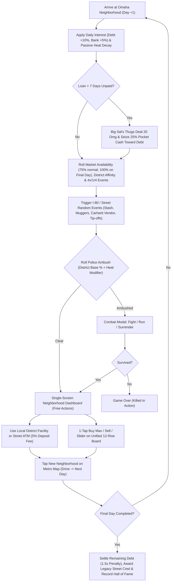

# Dope Wars: Omaha Metro Edition — Canonical Game Design Document (v1.1)

> [!NOTE]
> **Design & Technical Philosophy:**
> - **Platform & Tech Stack:** Built in **Godot 4.5.1 (GDScript)** using the exact architecture and CI/CD pipeline of *American Tycoon* (`1080 × 2400` portrait `canvas_items` stretch viewport, headless core state in `game/scripts/core/`, `.tres`-driven tuning in `game/config/tuning.tres` with an on-device **Balance Tuning Dev Panel**, automated headless simulation gates in `game/sim/`, and GitHub Actions → Firebase App Distribution APK builds).
> - **Target Hardware & Visual Style:** Optimized specifically for the **Google Pixel 10 Pro XL** in **Portrait (9:20)** using a sleek **Dark OLED "Omaha Street Noir" Dashboard** (`#0E131A` slate background, emerald cash counters, amber/cyan event badges, police scanner flashes).
> - **Zero-Scroll Unified Trading Board:** All 12 products occupy fixed muscle-memory rows in a single unified table showing today's Market Price, Event Signal, your Held Quantity, `Avg Paid` / live `P/L`, and 1-tap `[Buy Max]` / `[Sell]` buttons—so **100% of gameplay happens on one screen with zero scrolling**.

---

## 1. Core Concept & Game Loop

### 1.1 Premise & Win/Loss Conditions
- **Role:** Street-level hustler operating across the **8 districts of the Omaha Metro area**.
- **Starting Capital & Debt:** You start on **Day 1** in **North Omaha** with `$2,000` cash in your pocket and `$5,500` owed to **Big Sal**, the North Omaha Loan Shark.
- **Game Length Modes:**
  - **31-Day Classic Sprint** *(Default)*
  - **60-Day Metro Expansion**
  - **90-Day Kingpin Campaign**
  - **Endless Mode** *(Survival / Sandbox)*
- **Primary Objective:** Maximize **Final Net Worth** (`Cash + Bank Balance - Late Debt Penalty`) when you finish the final day.
- **Final Day Liquidation Guarantee:** On the final day of a run (e.g., Day 31), **all 12 products are guaranteed (`100%`) to have active market prices** in your destination neighborhood so you are never RNG-screwed out of selling your stash. Any product still left unsold when you tap **Finish Run** counts for `$0`.
- **Final Day Unpaid Debt Rule:**
  - If you finish the final day with `Debt > $0`, Big Sal automatically seizes **`1.5×` the remaining Debt** directly from your combined `Cash + Bank` as a late-collection penalty (`Final Net Worth = Cash + Bank - (1.5 × Debt)`).
  - If your total `Cash + Bank` cannot cover `1.5× Debt` (`Final Net Worth < 0`), Big Sal's enforcers catch up with you on 30th Street — **Game Over (Killed by Loan Shark)**.
- **Loss Conditions:**
  1. **Death in Combat / Enforcer Ambush:** Player Health drops to `0`.
  2. **Defaulting on Final Day:** Finishing the final day unable to cover `1.5×` your remaining Loan Shark debt.
- **Instant Auto-Save:** Every state change (trade, facility action, travel, combat round) auto-saves to `user://save_game.json` so locking or closing the app resumes seamlessly on your exact turn.

### 1.2 Turn Structure (1 Turn = 1 Day)


---

## 2. Player Statistics & Starting State

| Statistic | Starting Value | Range / Cap | Description |
| :--- | :--- | :--- | :--- |
| **Cash** | `$2,000` | `$0` – Unlimited | Liquid pocket money. Vulnerable to street muggers, enforcers, and police confiscation. |
| **Debt** | `$5,500` | `$0` – Unlimited | Owed to Big Sal in North Omaha. Compounds by **10% per day** (`8%/day` with Legacy Perk). |
| **Bank** | `$0` | `$0` – Unlimited | Held at First National. **100% immune** to muggers and cops. Earns **5% interest per day** (`7%/day` with Legacy Perk). |
| **Health** | `100 / 100` | `0` – `100` (`80` if kidney sold) | Hit points. `0` = Death. Restored at the Benson Back-Alley Clinic. |
| **Armor (Kevlar)** | `0` | `0` – `100` | Absorbs incoming gunfire damage intended for you before your Health is reduced. Bought at 24th St. Pawn & Gun. |
| **Carry Capacity** | `100` Pockets | `100` – `1,000+` | Maximum total units of product you can carry across your **Carhartt Coat + Crew + Vehicle Trunk**. |
| **Weapon Slots** | `0 / 1` (`+1` per Crew) | `1` Personal + `Crew` | Dedicated weapon slots. **Guns do NOT consume drug pockets.** You automatically wield your strongest gun; Crew wield the rest. |
| **Crew (Runners)** | `0` | `0` – `10` | Hired at the West Omaha Lounge. Each adds **+10 Carry Capacity**, **+1 Weapon Slot**, fires in combat, and has **`30 HP` per encounter** (shared 50/50 target pool with you; auto-patches to `30/30 HP` after surviving a shootout). |
| **Heat** | `0%` | `0%` – `100%` | Police attention meter. Rises from shootouts and huge trades; decays passively (especially in Bellevue) or via Old Market Lawyer / Council Bluffs Casino laundering. |
| **Vehicle** | *On Foot / Bus* | Tier 0 – Tier 4 | Upgraded at the Bellevue Auto & Chop Shop to add massive trunk capacity (`+60` to `+600` space) and escape bonuses. |
| **Location & Day** | `North Omaha`, `Day 1` | 8 Districts, `1–31+` | Driving to a different neighborhood advances the clock by `+1 Day`. |

---

## 3. The 8 Omaha Metro Neighborhoods, Facilities & Market Affinities

Every one of the 8 Omaha Metro neighborhoods features its own **Signature Facility**, **Base Police Presence**, and **Subtle Market Price Affinity** (`0.85×` cheaper local supply or `1.15×–1.20×` higher local demand, while `×4` Spikes and `÷4` Floods still dominate overall profit):

| # | Neighborhood | 1998 Equivalent | Signature Facility | Base Cop % | Subtle Market Affinities | District Flavor |
| :--- | :--- | :--- | :--- | :--- | :--- | :--- |
| 1 | **North Omaha** | Bronx | **First National Bank** (0% Fee) & **Big Sal's Loans** | Low (`10%`) | **Weed** & **Adderall** `0.90×` | Starting home base along 30th & Ames; financial hub. |
| 2 | **South Omaha** | Ghetto | **24th St. Pawn & Gun** *(Weapons & Armor)* | Moderate (`15%`) | **Meth** & **Weed** `0.85×` | Gritty industrial corridor; best spot to arm up early. |
| 3 | **Benson** | Central Park | **Benson Back-Alley Clinic** *(Heal & Kidney)* | Moderate (`15%`) | **Acid**, **Shrooms**, **Vape Carts** `0.85×`; **Molly** `1.15×` | Maple Street dive bars, indie venues, and underground chemists. |
| 4 | **West Omaha** | Manhattan | **The Regency Lounge** *(Hire Crew / Runners)* | High (`45%` base) | **Cocaine**, **Molly**, **Oxy**, **Adderall** `1.20×` | Regency, Village Pointe & Elkhorn wealth; top-dollar buyers, heavy OPD patrols. |
| 5 | **Council Bluffs** | Coney Island | **Riverboat High-Limit Room** *(Bet & Chip Launder)* | Low (`15%`) | **Meth** `0.80×`, **Hashish** `0.90×` | Across the river in "Counciltucky"—casinos, I-29 truck stops, low heat. |
| 6 | **Old Market** | Brooklyn | **Farnam St. Defense Attorney** *(Drop Heat)* | High (`35%` base) | **Cocaine**, **Molly**, **Shrooms**, **Weed** `1.15×` | Brick streets, tourists, CWS crowds, and downtown foot patrols. |
| 7 | **Blackstone** | Queens | **Farnam VIP Booth** *(Buy Actionable Intel)* | Medium (`25%`) | **Adderall**, **Oxy** `0.85×`; **Molly**, **Vape Carts** `1.15×` | UNMC med-center & Farnam nightlife strip; college & hospital supply/demand. |
| 8 | **Bellevue** | Staten Island | **Hwy 75 Auto & Chop Shop** *(Vehicle Upgrades)* | Low (`10%`, `-18%` Heat/day) | Neutral (`1.00×` across all tiers) | Quiet southern suburb near Offutt AFB; best place to buy trunks and cool down Heat. |

---

## 4. The Drug Market & Pricing Engine

### 4.1 Complete 12-Product Table (All 12 Eligible for `×4` Spikes & `÷4` Floods)
Each day upon arriving in a neighborhood:
1. **Availability Roll:** Each product has an independent **`75%` chance** to be active on the local market (except on the **Final Day**, where **all 12 products have a `100%` chance** to be active, and any product targeted by a Tip-Off is `100%` guaranteed).
2. **All 12 Products Participate in Market Events:** Every product can experience either a **`× 4` Spike** or a **`÷ 4` Flood**, weighted toward its classic 1998 role so there are **zero "dead rows"** on the board:
   $$\text{LocalPrice} = \text{round}\left(\text{Uniform}(\text{MinPrice}, \text{MaxPrice}) \times \text{DistrictAffinity} \times \text{EventMultiplier}\right)$$

| Row | Product Name | 1998 Slot | Normal Min | Normal Max | Primary Event Weight (`70%`) | Secondary Event Weight (`30%`) | Local Cheap (`0.85×`) | Local Pricy (`1.15×+`) |
| :--- | :--- | :--- | :--- | :--- | :--- | :--- | :--- | :--- |
| 1 | **Adderall** | *Ludes* | `$11` | `$60` | **Flood (`÷ 4`)** | Spike (`× 4`) | Blackstone, North O | West Omaha |
| 2 | **Meth** | *Speed* | `$90` | `$250` | **Spike (`× 4`)** | Flood (`÷ 4`) | Council Bluffs, South O | West Omaha |
| 3 | **Vape Carts** | *Peyote* | `$220` | `$700` | **Flood (`÷ 4`)** | Spike (`× 4`) | Benson | Blackstone, West O |
| 4 | **Weed** | *Weed* | `$315` | `$890` | **Flood (`÷ 4`)** | Spike (`× 4`) | South O, North O | Old Market |
| 5 | **Hashish** | *Hashish* | `$480` | `$1,280` | **Flood (`÷ 4`)** | Spike (`× 4`) | Council Bluffs | Old Market |
| 6 | **Oxy** | *Opium* | `$540` | `$1,250` | **Spike (`× 4`)** | Flood (`÷ 4`) | Blackstone | West Omaha |
| 7 | **Shrooms** | *Shrooms* | `$630` | `$1,300` | **Flood (`÷ 4`)** | Spike (`× 4`) | Benson | Old Market |
| 8 | **Acid** | *Acid* | `$1,000` | `$4,400` | **Flood (`÷ 4`)** | Spike (`× 4`) | Benson | Old Market |
| 9 | **PCP** | *PCP* | `$1,000` | `$2,500` | **Spike (`× 4`)** | Flood (`÷ 4`) | South Omaha | Council Bluffs |
| 10 | **Molly** | *MDA* | `$1,500` | `$4,400` | **Spike (`× 4`)** | Flood (`÷ 4`) | — | West O, Old Market, Blackstone |
| 11 | **Heroin** | *Heroin* | `$5,500` | `$13,000` | **Spike (`× 4`)** | Flood (`÷ 4`) | — | West Omaha |
| 12 | **Cocaine** | *Cocaine* | `$15,000` | `$29,000` | **Spike (`× 4`)** | Flood (`÷ 4`) | — | West O, Old Market |

### 4.2 Sample Market Event Messages (`÷ 4` Floods & `× 4` Spikes)
Each turn rolls up to **2 market event slots** (`35%` trigger chance per slot, plus any guaranteed Tip-Off event):
- **Floods (`÷ 4` — Cyan `❄️ 1/4!` Badge):**
  - *"UNMC finals week wrapped up and frat houses on Farnam are dumping cheap Adderall!"*
  - *"A convoy from Colorado slipped past the I-80 state troopers! Weed prices have bottomed out!"*
  - *"A basement chemist in Benson just flooded the market with cheap home-made Acid!"*
  - *"A fresh shipment of Hashish just rolled off a freight car at the Union Pacific yard!"*
  - *"An underground grower in Council Bluffs harvested a massive flush of cheap Shrooms!"*
- **Spikes (`× 4` — Amber/Red `🔥 4x!` Badge):**
  - *"College World Series fans packed downtown! Buyers are paying outrageous prices for Cocaine!"*
  - *"OPD raided a major stash house! Heroin prices are outrageous!"*
  - *"DEA shut down a suburban pill mill! Desperate buyers are paying outrageous prices for Oxy!"*
  - *"Late-shift truckers along I-80 are buying Meth at outrageous prices!"*
  - *"A weekend EDM festival at the riverfront has ravers buying Molly at outrageous prices!"*

---

## 5. Weapons, Armor & Capacity Progression

### 5.1 Weapons & Armor Ladder (24th St. Pawn & Gun — South Omaha)
- **Slot & Auto-Equip Rules:** You have **`1 + Crew` Weapon Slots**. Weapons **do not consume drug pockets**. Your personal slot automatically equips your highest-damage weapon, and your Crew wield your remaining weapons in descending order.
- **50% Trade-In Upgrade:** If all your Weapon Slots are full when you buy a stronger weapon, your weakest weapon is automatically traded in for **`50%` of its purchase price**!

| Item Name | Category | Price | Combat Effect | Notes |
| :--- | :--- | :--- | :--- | :--- |
| **Ruger .22 Pistol** | Weapon (Tier 1) | `$1,500` | `5` Damage (`65%` Hit) | Cheap early-game protection. |
| **Beretta 9mm** | Weapon (Tier 2) | `$5,000` | `10` Damage (`70%` Hit) | Solid street sidearm. |
| **Mossberg 12-Gauge Shotgun** | Weapon (Tier 3) | `$15,000` | `22` Damage (`75%` Hit) | Shreds OPD & Sheriff patrols. |
| **Sawed-Off AR-15 Pistol** | Weapon (Tier 4) | `$40,000` | `40` Damage (`80%` Hit) | Heavy firepower for DEA task forces. |
| **Full-Auto Micro Draco** | Weapon (Tier 5) | `$95,000` | `75` Damage (`85%` Hit) | End-game kingpin sweeper. |
| **Street Kevlar Vest** | Body Armor | `$8,500` | `+50 Armor` | Absorbs `50` damage aimed at you before Health drops. |
| **Tactical Plate Carrier** | Body Armor | `$35,000` | `+100 Armor` (Max) | Restores/maxes your personal Armor to `100`. |

### 5.2 Carry Capacity Progression (3 Sources)
1. **Carhartt Jacket Upgrades (Random Mega Saver / Kum & Go Encounter):**
   - Street vendor offers **+40 Pockets** for `$200` (1st upgrade), scaling to `$800`, `$2,500`, `$8,000` on subsequent offers.
2. **Hiring Crew / Runners (The Regency Lounge — West Omaha):**
   - Costs `$20,000` for your 1st Runner, scaling by `+$10,000` per additional Runner (up to 10 Crew).
   - Each Runner grants **+10 Carry Capacity**, **+1 Weapon Slot**, fires their assigned gun in combat, and has **`30 HP` per shootout**.
   - **Crew Death Penalty & Overflow Rule:** If a Runner takes `30` damage during a shootout and dies:
     - You lose `1` Crew member, their `+10` Carry Capacity, and the **weakest gun** in your arsenal (if all weapon slots were full).
     - If your carried drugs now exceed your new `MaxCapacity`, the **cheapest carried product units automatically spill onto the pavement** until `UsedCapacity == MaxCapacity`.
3. **Vehicle & Trunk Upgrades (Hwy 75 Auto & Chop Shop — Bellevue):**

| Tier | Vehicle Name | Price | Bonus Capacity | Escape Bonus | Flavor |
| :--- | :--- | :--- | :--- | :--- | :--- |
| 0 | **On Foot / Metro Bus** | `$0` *(Start)* | `+0` Pockets | `+0%` | Riding the ORBT bus down Dodge. |
| 1 | **'98 Honda Civic (Beater)** | `$12,000` | `+60` Trunk Space | `+5%` Run Chance | Blends into South O traffic. |
| 2 | **Chevy Tahoe (Tinted)** | `$55,000` | `+150` Trunk Space | `+10%` Run Chance | Hidden floor compartments. |
| 3 | **Ford E-350 Cargo Van** | `$200,000` | `+320` Trunk Space | `+15%` Run Chance | Contractor decals; hauls serious weight. |
| 4 | **Armored Escalade ESV** | `$750,000` | `+600` Trunk Space | `+25%` Run Chance | Bullet-resistant glass (`-20%` cop damage). |

---

## 6. Police Heat & Combat System

### 6.1 The 0–100% Heat Meter
- **How Heat Rises:**
  - Fighting/killing police officers (`+12%` per officer downed).
  - Running from a police stop (`+5%`).
  - Executing massive single-day trades over `$100,000` (`+3%` to `+8%`).
- **How Heat Decays:**
  - Passive daily decay (`-3%/day` normally; **`-18%/day` when arriving in Bellevue**).
  - Paying the **Farnam St. Defense Attorney** in the **Old Market** (`-35%` or clear to `0%`).
  - Washing chips via **Cage Chip Laundering** at the **Council Bluffs Riverboat Casino** (`-15%` Heat).
- **Ambush Probability:**
  $$\text{AmbushChance} = \text{clamp}\left(\text{DistrictBaseCop\%} + (\text{Heat} \times 0.35), 5\%, 75\%\right)$$

### 6.2 Law Enforcement Tiers (Determined by Current Heat)

| Heat Bracket | Pursuing Unit | Backup Officers | Unit HP (Each) | Damage per Shot | Bounty / Loot on Victory |
| :--- | :--- | :--- | :--- | :--- | :--- |
| **`0% – 34%` Heat** | **Officer Hardass (OPD Patrol)** | `0 – 2` Officers | `25 HP` | `4 – 9` dmg | `$1,000 – $4,000` |
| **`35% – 69%` Heat** | **Sgt. Bob (Douglas Co. Sheriff)** | `1 – 3` Deputies | `55 HP` | `9 – 16` dmg | `$5,000 – $15,000` |
| **`70% – 100%` Heat** | **Agent Miller (I-80 DEA Task Force)** | `2 – 5` Federal Agents | `110 HP` | `16 – 28` dmg | `$20,000 – $60,000` |

### 6.3 Combat Resolution Loop (Shared 50/50 Target Pool)
1. **Fight (Requires ≥ 1 Weapon):**
   - You and each armed Crew member fire once per round. Backup officers are eliminated first before the lead officer takes damage.
   - Surviving officers return fire:
     - **Shared Target Pool:** When you have active Crew, each incoming cop shot rolls a **`50%` chance to hit your front Crew member** (who has **`30 HP`** for the encounter) and a **`50%` chance to hit you** (depleting your **Armor** first, then your **Health**).
     - Any Crew member who survives the shootout **automatically patches back up to `30/30 HP`** once combat ends.
2. **Run (Always Available):**
   - $$\text{EscapeChance} = \text{clamp}\left(55\% + \text{VehicleBonus} - (6\% \times \text{BackupOfficers}), 20\%, 85\%\right)$$
   - **Success:** Combat ends and you enter the neighborhood market normally.
   - **Failure:** Cops get one free volley of fire, and the combat modal repeats.
3. **Surrender:**
   - Cops confiscate `100%` of carried drugs and `25%` of pocket Cash, reset **Heat** to `10%`, and advance `+1 Day` (on the Final Day, skips straight to Final Settlement without touching your Bank balance).

---

## 7. Complete Guide to Banking & the 8 Neighborhood Facilities

### 7.1 Universal Street ATM vs. North Omaha Banking
- **Universal Street ATM (Available in All 8 Neighborhoods):**
  - You can **Deposit** pocket cash into your First National Bank account from **any neighborhood** at any time for a **`5%` convenience fee** (`95%` credited to Bank; `0%` fee if you have the *First National VIP* Legacy Perk).
- **First National Bank Branch (North Omaha — In-Person):**
  - **0% Fee Deposits** and **Full Withdrawals**. Bank balance earns **`+5%/day` compound interest** (`+7%/day` with *First National VIP*).

### 7.2 All 8 District Signature Facilities

| Neighborhood | Facility Name | Mechanics & Pricing |
| :--- | :--- | :--- |
| **1. North Omaha** | **First National Bank** & **Big Sal's Loans** | **Big Sal's Dynamic Credit Line:** Starting `$5,500` debt compounds at `10%/day` (`8%/day` with perk). Once initial debt is paid to `$0`, Big Sal unlocks a **Street Credit Line** up to **`max($25,000, 50% of Net Worth)`** (capped at `$250,000`) for high-leverage plays!<br>**7-Day Enforcer Rule:** If any loan balance goes **7 consecutive days** without at least a `10%` payment, Big Sal's thugs ambush you for **`20 HP` damage** and seize up to **`25%` of your pocket Cash** toward the debt. |
| **2. South Omaha** | **24th St. Pawn & Gun** | Buy/upgrade personal & Crew weapons (`.22` up to `Micro Draco` with `50%` trade-in on replaced guns) and purchase **Kevlar Armor** (`+50` or `+100`). |
| **3. Benson** | **Benson Back-Alley Clinic** | Restore Health at `max($100, min($1,000, floor(NetWorth * 0.002)))` per HP (`1-Tap Full Heal`).<br>**Sell a Kidney:** Once per run when desperate, sell a kidney for **`$2,500` cash** (permanently caps Max HP at `80`). |
| **4. West Omaha** | **The Regency Lounge** | Hire **Crew / Runners** (`$20k` base, `+$10k` per existing member). Adds `+10` Capacity, `+1` Weapon Slot, and `30 HP` shared-target combat protection. |
| **5. Council Bluffs** | **Riverboat High-Limit Room** | **High-Card Double-or-Nothing:** Wager `$1,000` to `$100,000` (`50%` chance to double your bet; once per visit).<br>**Cage Chip Laundering:** Choose a wash tier (`$5k`, `$25k`, `$100k`, or `Max`) — the casino takes a **`10%` house cut**, wires the remaining **`90%` directly into your First National Bank account**, and drops **Heat by `-15%`** (once per visit). |
| **6. Old Market** | **Farnam St. Defense Attorney** | Pay a legal retainer (`$1,500` early game, scaling with Heat & Net Worth) to drop **Heat by `-35%`** or **Clear All Heat (`0%`)**. |
| **7. Blackstone** | **Farnam VIP Booth** | Pay `$1,000–$10,000` (scaling with Day) and choose either:<br>1. **"Tip on Tomorrow's 4x Spike (Buy Now)":** Picks a product **currently on sale in Blackstone today** so you can immediately buy a full load before driving, and guarantees (`100%`) it appears at `× 4` price tomorrow!<br>2. **"Tip on Tomorrow's 1/4 Flood":** Reveals which product will crash to `÷ 4` tomorrow (`100%` guaranteed on tomorrow's market) so you can clear coat space today. |
| **8. Bellevue** | **Hwy 75 Auto & Chop Shop** | Buy **Vehicle & Trunk Upgrades** (`Civic` → `Tahoe` → `Cargo Van` → `Armored Escalade`). Simply arriving in Bellevue also sheds **`-18%` Heat**. |

---

## 8. Non-Market Random Events (Omaha Street Encounters)

When driving between neighborhoods, `0–2` street events may fire (logged in the live scanner, with modal prompts only when a player choice is required):

| Event Name | Omaha Flavor Text | Mechanical Effect |
| :--- | :--- | :--- |
| **Found Stash** | *"You found 6 units of Weed in an abandoned backpack near Gene Leahy Mall!"* | Adds `2–8` free units of a random product (up to free capacity). |
| **Kum & Go Hookup** | *"You bumped into an old buddy outside a Kum & Go! He tosses you 5 bags of Meth."* | Adds `3–6` free units of a Tier 1–2 product. |
| **Casino Lot Mugging** | *"You got jumped in a dark lot behind a Council Bluffs casino! You lost $450!"* | Loses `10%–20%` of pocket Cash. Bank money is untouched. |
| **OPD K-9 Chase** | *"OPD K-9 unit chased you across Saddle Creek! You dropped some stash hopping a fence!"* | Loses `10%–25%` of one randomly carried product. |
| **Dodge St. Pothole** | *"You hit a crater-sized pothole on Dodge Street and ruined 3 hits of Acid!"* | Loses `1–5` units of one carried product. |
| **Carhartt Vendor** | *"A guy outside Mega Saver asks: 'Want to buy a bigger Carhartt jacket (+40 pockets) for $200?'"* | Choice Modal: Pay `$200` (scales per upgrade) for `+40` Carry Capacity. |
| **Camaro Trunk Gun** | *"A sketchy guy in an IROC-Z offers to sell you a Beretta 9mm out of his trunk for $3,500."* | Choice Modal: Discounted weapon purchase on the spot. |
| **Barfly Tip-Off** | *"A regular at a Benson dive bar whispers: 'Word is a huge Cocaine bust is hitting tomorrow!'"* | Free guaranteed `× 4` Spike or `÷ 4` Flood on the named product tomorrow. |
| **Omaha Atmosphere** | *"Traffic is backed up on I-480 near the bridge."* / *"The smell of Runza drifts across the lot."* | Flavor text in the scanner log. |

---

## 9. Meta-Progression ("Omaha Kingpin Legacy") & Dev Tuning

### 9.1 Cross-Run Legacy Progression (No Slot Limit)
Every completed run (where you survive and settle with Big Sal) awards **Street Cred (Legacy Points)** based on your Final Net Worth tier (`$100k` = 1 Cred, `$1M` = 2 Cred, `$10M` = 4 Cred, `$50M+` = 7 Cred).
- **No Equip Slot Limit:** Any Legacy Perk you unlock with Street Cred can be **toggled ON simultaneously** for any future run:
  1. **Connected Cousin (`Cost: 1 Cred`):** Big Sal's daily loan interest drops from `10%` to **`8%`**.
  2. **Glovebox .22 (`Cost: 1 Cred`):** Start Day 1 with a **Ruger .22 Pistol** already equipped.
  3. **Carhartt XL (`Cost: 2 Cred`):** Start Day 1 with **`140` Carry Capacity** instead of `100`.
  4. **First National VIP (`Cost: 2 Cred`):** Bank interest increases from `5%/day` to **`7%/day`**, **waives the `5%` Street ATM deposit fee**, and unlocks **remote Bank Withdrawals** from any neighborhood.
  5. **Police Scanner (`Cost: 3 Cred`):** Displays a `24h Forecast` badge whenever a natural market event is brewing for tomorrow, and reduces base Police Ambush chance by `-5%`.
  6. **'98 Civic Keys (`Cost: 4 Cred`):** Start Day 1 with the **'98 Honda Civic** (`+60` Trunk Space, `+5%` Run Chance).

### 9.2 American Tycoon-Style Balance Tuning Dev Panel
- All numbers (drug min/max prices, `×4`/`÷4` multipliers, event probabilities, district affinities, cop HP/damage, facility costs, interest rates) live in **`game/config/tuning.tres`** (`TuningConfig` resource class) — **never hardcoded in GDScript**.
- Tapping the top-bar **⚙️ Tuning** button opens an on-device **Balance Tuning Overlay** allowing you to tweak any game constant live on your Pixel 10 Pro XL, save overrides to `user://`, or reset to defaults.

---

## 10. Pixel 10 Pro XL Portrait UI Architecture (`1080 × 2400` Zero-Scroll Dashboard)

Designed for **Sleek Dark OLED "Omaha Street Noir"** (`#0E131A` deep slate) with a **Unified 12-Row Fixed-Position Trading Board** so every product stays in the exact same vertical muscle-memory slot on every turn with **zero scrolling**:

```
+-------------------------------------------------------------------+
| DOPE WARS: OMAHA              Day 12/31   [🏧 ATM] [⚙️] [🏆] [New] |
+-------------------------------------------------------------------+
| 💵 Cash: $48,200      🏦 Bank: $110,000 (+5%)   💎 Net: $158,200   |
| 🦈 Debt: $0           ❤️ HP: 100/100  🛡️ Arm: 50  🚨 Heat: 22% OPD |
| 🧥 Space: 85 / 160 ('98 Civic)   🔫 Guns: 2/2 (Shotgun)  👥 Crew: 1|
+-------------------------------------------------------------------+
| OMAHA METRO MAP (TAP TO DRIVE -> +1 DAY)                          |
| [1. North O 🏦🦈] [2. South O 🔫] [3. Benson 🏥] [4. West O ★🍸]  |
| [5. C.Bluffs 🎰]  [6. Old Mkt ⚖️] [7. Blackst 🥂] [8. Bellev 🚗]  |
| 📍 PARKED IN WEST OMAHA:  [ 🍸 Visit The Regency Lounge ($30k) ]   |
+-------------------------------------------------------------------+
| 📻 > Day 12: Pulled into West Omaha.                              |
|    > 🔥 CRAZE: CWS fans buying Cocaine at outrageous prices!      |
+-------------------------------------------------------------------+
| UNIFIED STREET MARKET & STASH (Tap Row for Slider | 1-Tap Max/Sell)|
| #  Product    Market Price  Signal   Held (Avg / P&L)   Quick Act |
| ----------------------------------------------------------------- |
| 1  Adderall   $54           📈 Hi    0                  [Buy Max] |
| 2  Meth       $190          Normal   0                  [Buy Max] |
| 3  Vape Carts — (No Mkt)    —        0                  [  —  ]   |
| 4  Weed       $112          ❄️ 1/4!  0                  [Buy Max] |
| 5  Hashish    $820          Normal   0                  [Buy Max] |
| 6  Oxy        $4,120        🔥 4x!   0                  [Buy Max] |
| 7  Shrooms    $890          Normal   0                  [Buy Max] |
| 8  Acid       $2,450        Normal   60 ($310 | +$128k) [Sell 60] |
| 9  PCP        — (No Mkt)    —        10 ($1.4k| Unlist) [Dump 10] |
| 10 Molly      $3,800        📈 Hi    0                  [Buy Max] |
| 11 Heroin     $9,800        Normal   0                  [Buy Max] |
| 12 Cocaine    $88,400       🔥 4x!   15 ($18k | +$1.05M)[Sell 15] |
+-------------------------------------------------------------------+
```

### 10.1 Unified Board Touch Ergonomics
- **Fixed Muscle-Memory Rows (1–12):** `Adderall` is always Row 1 and `Cocaine` is always Row 12. If a product rolled unavailable (`25%` chance) in the current neighborhood, its price displays `— (No Mkt)` and its action button disables (or shows **`[Dump]`** if you are holding units you want to ditch for space).
- **Smart Right-Edge Quick Button:**
  - When `Held == 0` and the product is available: shows **`[Buy Max]`** (1 tap buys `min(floor(Cash / Price), FreeSpace)`).
  - When `Held > 0` and the product is available: shows **`[Sell Qty]`** highlighted in emerald green if `MarketPrice > AvgPaid` (or amber if at a loss) so 1 tap liquidates your stack!
  - Tapping anywhere on the **left/middle of a Product Row** opens the **Trade Modal** where you can both **Buy More** or **Sell Partial** (`25%`, `50%`, `75%`, `Max`, or slider).
