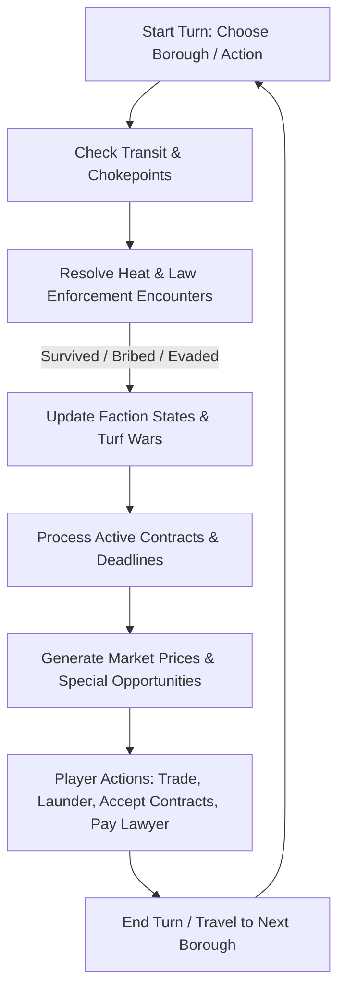
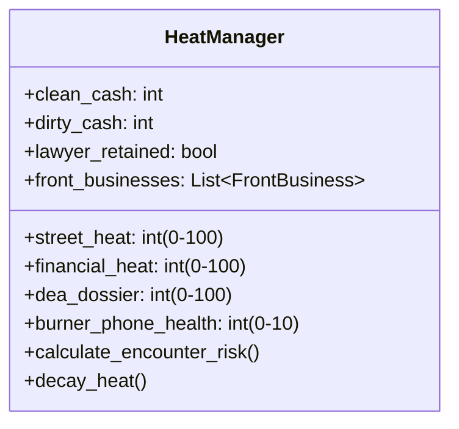
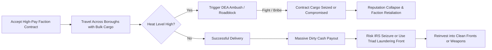

# Implementation Plan: Dope Wars Expansion Systems

This document outlines the detailed architecture, mathematical models, data schemas, and phased execution roadmap for integrating **Option 2 (Multi-Tier Heat & Investigation Economy)** and **Option 4 (Factions, Turf War & Timed Contracts)** into *Dope Wars*.

---

## 1. System Integration & Turn Cycle Overview

In classic *Dope Wars*, each turn advances when traveling between boroughs. The new systems integrate directly into the turn resolution cycle without breaking the brisk pace of the core buy-low/sell-high loop.



---

## 2. System Deep Dive: Multi-Tier Heat Economy ("The Wire")

The goal is to replace pure random police combat rolls with a deterministic, player-controllable risk envelope that tracks illegal operations over time.

### 2.1 The Three Heat Tracks



| Heat Track | What Increases It | What It Triggers | How to Mitigate / Lower It |
| :--- | :--- | :--- | :--- |
| **Street Heat** (0–100) | Violence, high-volume transactions in the same borough, running from police | Stop-and-frisk at subway stations, tactical roadblocks, SWAT combat encounters | Laying low in low-volume boroughs, discarding hot weapons, bribing local beat cops |
| **Financial Heat** (0–100) | Carrying large dirty cash amounts (e.g. >\$25k), rapid deposits to standard bank | Civil asset forfeiture (cash seized), account freezes, IRS audits | Investing in **Front Businesses** (bodegas, laundromats, car washes) to wash money over time |
| **DEA Dossier** (0–100) | Dealing Class-A narcotics (cocaine, heroin), repeated deals with tapped contacts | Wiretap events, sting buys (undercover cops posing as high-yield buyers), no-knock raid on stash | Changing burner phones, tipping off rivals, keeping a crooked defense attorney on monthly retainer |

### 2.2 Mechanics & Risk Gates

1. **Dirty vs. Clean Cash:**
   - Cash earned from street deals is **Dirty Cash**.
   - Standard banks only accept clean cash or small, structured deposits (< \$5,000 / week) without raising Financial Heat.
   - Front businesses wash dirty cash into clean cash each turn at a 15–30% "laundering fee" depending on the business tier.
2. **Burner Phone Decay:**
   - Every contract accepted or large deal completed reduces the phone's security rating by 1.
   - At 0 security, calls are tapped: accepting any contract gives the DEA instant tracking and +20 Dossier Heat.
   - New burners cost \$250–\$1,000 at electronic shops / corner bodegas.
3. **Defense Attorney Retainer:**
   - Retaining a crooked lawyer costs \$1,500 / week.
   - If arrested, the lawyer drops charges or negotiates bail at a cash discount, preventing a premature "Game Over".

---

## 3. System Deep Dive: Factions, Turf War & Timed Contracts

Factions create evolving geopolitical dynamics across the city's 5–6 boroughs, giving the player allies, enemies, and high-reward objectives.

### 3.1 The Faction Ecosystem

| Faction Name | Primary Turf | Specialty / Supply Bias | Unique Perk at High Reputation (+50) |
| :--- | :--- | :--- | :--- |
| **The Five Points Syndicate** | Manhattan / Brooklyn | High-end imports (Cocaine, Designer Pills) | Access to private luxury buyers; VIP safehouse access |
| **Iron Cross MC** | Queens / Staten Island | Methamphetamine, Firearms, Body Armor | Wholesale weapons discount (40% off); combat backup in encounters |
| **Red Dragon Triad** | Chinatown / Queens | Opium derivatives, Counterfeit cash, Laundering | 50% discount on money laundering fees via shell companies |
| **Street Crews (Uptown Bloc)** | Bronx / Harlem | Weed, Crack, Street-level muscle | Immune to street muggings in the Bronx; early warning on police raids |

### 3.2 Reputation Dynamics

Player standing with each faction ranges from **-100 (Kill on Sight)** to **+100 (Honored Partner)**:
- **Hostile (-100 to -30):** Ambushed by hitmen when entering their turf; local dealers refuse to sell.
- **Neutral (-29 to +29):** Standard street prices; basic contract opportunities.
- **Allied (+30 to +69):** Bulk wholesale discounts (10–20%); access to local stash houses.
- **Kingpin Ally (+70 to +100):** Exclusive high-reward syndicate contracts; armed bodyguards accompany player.

### 3.3 Timed Syndicate Contracts

Instead of purely passive market trading, syndicates issue structured jobs via pagers/burner phones:

```json
{
  "contract_id": "CNT_BRONX_EXPRESS_04",
  "issuer_faction": "uptown_bloc",
  "cargo_type": "cocaine",
  "quantity": 25,
  "pickup_borough": "manhattan",
  "delivery_borough": "bronx",
  "deadline_turns": 3,
  "reward_cash": 45000,
  "rep_reward": 15,
  "reputation_penalty_on_fail": -25,
  "condition_constraints": [
    "no_subway_travel",
    "must_carry_under_30_street_heat"
  ]
}
```

### 3.4 Dynamic Turf Wars & Contagion

- Each turn, neighboring factions have a chance to contest border districts (e.g., Uptown Bloc vs. Five Points contesting North Brooklyn).
- **Turf War State Effects:**
  - Weapons and armor prices increase by 200–300%.
  - Combat encounter rate increases by +40%.
  - Narcotic prices plunge due to disrupted distribution, or spike due to severe local drought.
  - The player can choose to supply weapons to one side to influence the outcome and earn massive rep.

---

## 4. Systems Interconnection (The Emergent Loop)

The combination of Systems 2 and 4 produces emergent narrative gameplay:



1. **Burned Deliveries:** Getting caught by police during a faction delivery forfeits their cargo, turning that faction hostile unless you can pay restitution.
2. **Framing Competitors:** A corrupt lawyer or Triad contact can plant false evidence on a rival faction's stash house, triggering a DEA raid on them and resetting your own heat.
3. **Laundering Alliances:** Allies offer clean financial conduits, enabling players to convert street profits into permanent safehouse assets.

---

## 5. Technical Architecture & File Layout

We propose building this with an **isolated engine layer** (headless state machine) separated from the presentation layer (CLI or Web terminal UI) so it can run anywhere.

```
dope-wars-expanded/
├── src/
│   ├── engine/
│   │   ├── GameEngine.ts            # Master turn loop & state coordinator
│   │   ├── types.ts                 # Enums, interfaces for heat, factions, items
│   │   ├── systems/
│   │   │   ├── EconomySystem.ts     # Core commodity price generation
│   │   │   ├── HeatSystem.ts        # Street, Financial, Dossier heat tracking
│   │   │   ├── FactionSystem.ts     # Reputations, turf wars, faction perks
│   │   │   ├── ContractSystem.ts    # Procedural timed contracts generator
│   │   │   └── EncounterSystem.ts   # Police & gang encounter resolver
│   │   └── data/
│   │       ├── boroughs.json        # Borough configs, connections, transit nodes
│   │       ├── drugs.json           # Base prices, volatility, DEA sensitivity
│   │       └── factions.json        # Faction traits, leaders, starting turfs
│   └── ui/
│       ├── cli/                     # Rich terminal interface (Inquirer / Blessed)
│       └── web/                     # Optional browser-based retro dashboard
├── tests/                           # Unit tests for heat curves & contract math
├── package.json
└── tsconfig.json
```

---

## 6. Phased Execution Roadmap

| Phase | Milestone | Deliverables |
| :--- | :--- | :--- |
| **Phase 1** | **Core Data Models & State Machine** | Define types for Player, Inventory, Boroughs, Heat, and Factions. Implement turn loop. |
| **Phase 2** | **Heat & Investigation Engine** | Implement 3-tier heat math, decay curves, dirty cash mechanics, and police raid thresholds. |
| **Phase 3** | **Factions & Contract System** | Implement faction rep scales, procedural contract generator, deadline ticking, and turf contest logic. |
| **Phase 4** | **Encounter & Mitigation Suite** | Add money laundering fronts, lawyer retainer events, burner phone degradation, and sting events. |
| **Phase 5** | **Balancing, UI & Playtesting** | Terminal/CLI display integration, test runs, difficulty balancing (e.g., preventing death spirals). |

---

## 7. Open Questions & Design Decisions for You

Before we start building, please let me know your thoughts on these parameters:

1. **Target Platform / Interface:** Do you prefer a **Node.js/TypeScript interactive terminal CLI** (retaining the classic retro terminal look with color), or a **Web-based retro UI** (HTML/React)?
2. **Game Mode Length:** Classic *Dope Wars* is 30 or 60 days. With these long-term systems (laundering, turf control), should we support an **Endless / Kingpin mode** alongside the classic 30-day mode?
3. **Permadeath vs. Prison Sentences:** In classic, police death is game over. Should getting arrested with a lawyer result in a **bail fine / prison sentence (skipping X days and losing inventory)** rather than immediate permadeath?
